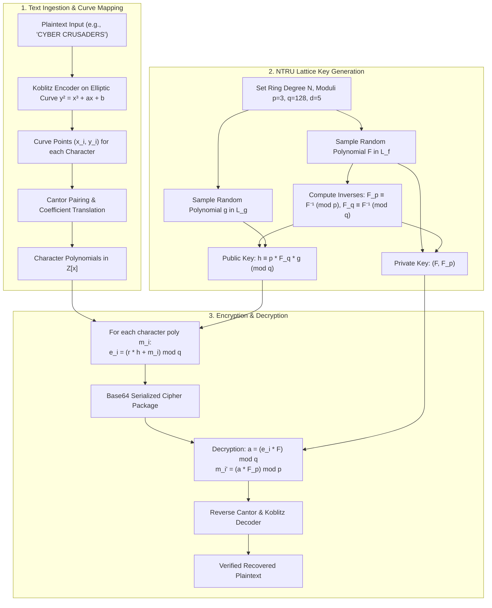

# 🛡️ NTRU-Koblitz — Quantum-Safe Lattice & Elliptic Curve Cryptosystem

<div align="center">

### *Post-Quantum Character-Wise Polynomial Cryptography combining NTRU Lattice Encryption with ECC Koblitz Point Encoding*

[](https://www.python.org/)
[](https://flask.palletsprojects.com/)
[](https://www.sympy.org/)
[-8A2BE2?style=for-the-badge)]()
[]()
[](http://www.gnu.org/licenses/gpl-3.0)

<br/>

<p align="center">
  <a href="#-overview">Overview</a> •
  <a href="#-key-features">Key Features</a> •
  <a href="#-cryptographic-workflow">Workflow</a> •
  <a href="#-mathematical-foundation">Mathematical Design</a> •
  <a href="#-web-portal-demonstration">Web Portal</a> •
  <a href="#-getting-started">Getting Started</a> •
  <a href="#-research-benchmarks">Research & Benchmarks</a>
</p>

</div>

---

## 🔬 Overview

Classical public-key cryptosystems like RSA, Diffie-Hellman, and standard ECC rely on the hardness of integer factorization or discrete logarithms—problems that can be broken in polynomial time by Shor's algorithm on quantum computers.

**NTRU** is an open-source, lattice-based public key cryptosystem defined over the truncated polynomial ring $\mathbb{Z}[x]/(x^N - 1)$. Resistant to quantum adversaries and computationally more efficient than traditional cryptosystems, NTRU operates via cyclic polynomial convolutions.

This project implements an **Enhanced NTRU Cryptosystem**:
1. **Character-Wise Koblitz Encoding**: Each character of plaintext is deterministically embedded onto an elliptic curve $E: y^2 \equiv x^3 + ax + b \pmod{p}$.
2. **Cantor Pairing & Polynomial Decomposition**: Elliptic curve points $(x, y)$ are paired and mapped to coefficient sequences in $\mathbb{Z}$.
3. **Per-Character Lattice Polynomials**: Every character is represented by its own discrete polynomial in the ring $\mathcal{R}$, vastly increasing ciphertext diffusion and mathematical obscurity against cryptanalysis.
4. **Interactive Web Console**: A full-featured Flask interface allowing instant encryption, base64 ciphertext generation, and verified decryption.

---

## ✨ Key Features

- **Quantum Resistance**: Built upon the shortest vector problem (SVP) in a lattice, offering protection against quantum attack vectors.
- **Koblitz Elliptic Mapping**: Converts alphanumeric and special characters into authentic discrete elliptic curve coordinates before polynomial construction.
- **Dynamic Parameter Selection**: Configurable $(N, p, q, d)$ lattice parameters ensuring $q > (6d + 1)p$ for guaranteed invertible decryption.
- **Linear-Time Decryption**: Optimized modular polynomial arithmetic yields near-instant decryption speeds with zero information loss.
- **Interactive Flask Terminal**: Includes a web console for encrypting, copying base64 cipher payloads, and verifying decrypted plaintexts.
- **Jupyter Research Notebooks**: Pre-packaged experimental suites benchmarking Cantor pairing, string length scaling, and randomized noise resistance.

---

## 🔄 Cryptographic Workflow



---

## 📐 Mathematical Design

### 1. Polynomial Ring Definition
All polynomial operations take place in the quotient ring:
$$\mathcal{R} = \mathbb{Z}[x]/(x^N - 1)$$

- $N$: Prime integer defining the degree of the ring (typically $N \in [11, 107]$ for testing, higher for production).
- $p$: Small modulus (typically $p = 3$).
- $q$: Large modulus (typically power-of-two, $q = 128$ or $256$).
- $d$: Number of ones / coefficients in random perturbation polynomials $L(d_1, d_2)$.

### 2. Encryption
Given public key $h(x)$, random blinding polynomial $r(x)$, and encoded character message polynomial $m(x)$:
$$e(x) \equiv r(x) \star h(x) + m(x) \pmod q$$
*(where $\star$ denotes cyclic convolution modulo $x^N - 1$)*.

### 3. Decryption
Using private key polynomial $F(x)$ and its modular inverse $F_p(x) \equiv F^{-1} \pmod p$:
$$a(x) \equiv e(x) \star F(x) \pmod q$$
Centered mod $q$ to the interval $[-q/2, q/2]$:
$$m(x) \equiv a(x) \star F_p(x) \pmod p$$

---

## 🖥️ Web Portal Demonstration

The Flask console provides an interactive web interface:

```
┌────────────────────────────────────────────────────────────────────────┐
│                        CYBER CRUSADERS PORTAL                          │
├────────────────────────────────────────────────────────────────────────┤
│  [ ENCRYPTION SECTION ]                                                │
│  Input Message:  HELLO WORLD                                           │
│  [ Encrypt Button ]                                                    │
│  Encrypted Payload: eyJOIjogMTEsICJjaXBoZXJzIjogW1stMjgsIC00...==     │
│  [ 📋 Copy to Clipboard ]                                              │
├────────────────────────────────────────────────────────────────────────┤
│  [ DECRYPTION SECTION ]                                                │
│  Ciphertext Input:  <paste base64 ciphertext>                          │
│  [ Decrypt Button ]                                                    │
│  Decrypted Plaintext: HELLO WORLD   ✅ (Verified Identity)             │
└────────────────────────────────────────────────────────────────────────┘
```

---

## 📂 Repository Structure

```text
NTRU_cryptography/
├── app.py                             # Main Flask application with full roundtrip encryption
├── main.py                            # Alternative lightweight web controller
├── NtruEncrypt.py                     # Core NTRU keypair generation, encrypt, decrypt
├── Polynomial.py                      # Polynomial class with cyclic convolution & arithmetic
├── num_to_polynomial.py               # Cantor pairing & polynomial conversions
├── character_wise_koblitz_encoding.py # Elliptic curve character mapping routines
├── polynomial_inverter.py             # Extended Euclidean algorithm for polynomial rings
├── templates/
│   └── index.html                     # Cyber Crusaders gold/navy themed web UI
├── static/                            # Stylesheets, icons, and assets
├── Results/                           # Graphical benchmarks and research charts
├── image_encryption_decryption.ipynb  # Extension to image data encryption
├── ntru_cantor_benchmark.ipynb        # Benchmarking Cantor mapping vs sum-of-squares
├── stringlength_vs_time.ipynb         # Latency scaling analysis across string lengths
├── requirements.txt                   # Project dependencies (sympy, flask, matplotlib)
└── README.md                          # Comprehensive system documentation
```

---

## 🚀 Getting Started

### Prerequisites

- **Python 3.8+** (Tested up to Python 3.13)
- `pip` package manager

### 1. Installation

```bash
# Clone the repository
git clone https://github.com/AP952005/NTRU_cryptography.git
cd NTRU_cryptography

# Install required packages
pip install -r requirements.txt
```

### 2. Launch the Web Interface

```bash
python app.py
```

Open your browser and navigate to:
```
http://127.0.0.1:5000/
```

### 3. Programmatic Usage (Python SDK)

```python
from NtruEncrypt import generate_keypair, encrypt, decrypt
from num_to_polynomial import koblitz_encoder, points_decoder, koblitz_decoder
from Polynomial import Zx

# Configuration parameters
p, q, d = 3, 128, 5
elliptic_a, elliptic_b = 50, 30

# 1. Encode text
message = "QUANTUM SAFE"
char_polys, N = koblitz_encoder(message, elliptic_a, elliptic_b)

# 2. Key generation
public_key, private_key = generate_keypair(p, q, d, N)

# 3. Encrypt each character polynomial
ciphers = [encrypt(poly, public_key, d, N, q) for poly in char_polys]

# 4. Decrypt and decode
decrypted_polys = [decrypt(c, private_key, p, q, N).coeffs for c in ciphers]
recovered_text = koblitz_decoder(points_decoder(decrypted_polys))

print(f"Original:  {message}")
print(f"Recovered: {recovered_text}")
assert message == recovered_text
```

---

## 📊 Research & Experiments

The repository includes research experiments documented across Jupyter notebooks:
- **`ntru_cantor_benchmark.ipynb`**: Comparison between Cantor pairing and sum-of-squares mappings for point compression.
- **`stringlength_vs_time.ipynb`**: Demonstrates $O(N \log N)$ computational scaling for character-wise polynomial convolutions.
- **`image_encryption_decryption.ipynb`**: Demonstrates applying the NTRU lattice framework to raw image pixel matrices.

---

## 📜 License

This project is licensed under the **GNU General Public License v3.0 (GPL-3.0)**. See `LICENSE` for details.