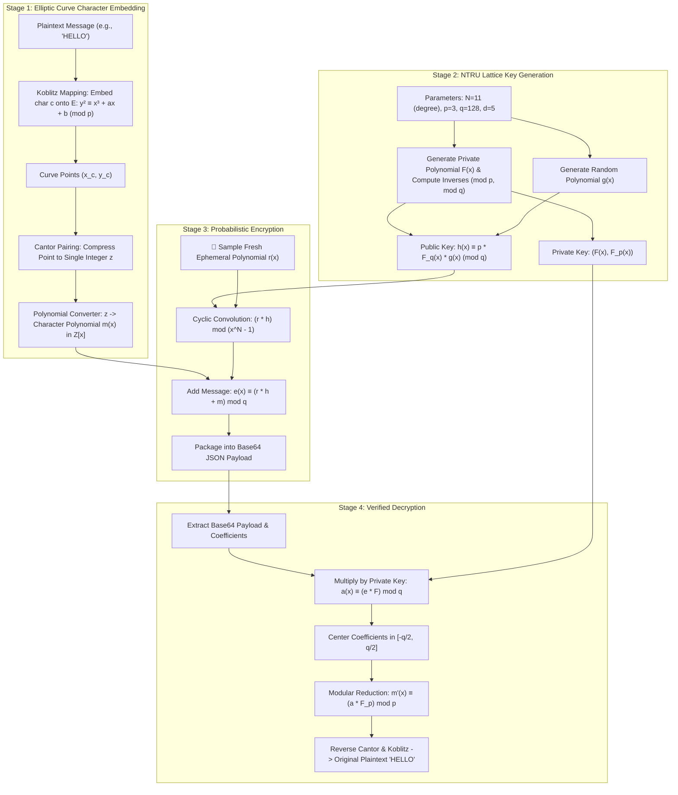

# 🔒 QuantumText — Probabilistic Post-Quantum Text Encryption

<div align="center">

### *Why Encrypting the Same Message Twice NEVER Produces the Same Ciphertext*
#### *Combining Lattice-Based NTRU Polynomial Arithmetic with Elliptic Curve Point Encoding*

[](https://www.python.org/)
[]()
[-8A2BE2?style=for-the-badge)]()
[]()
[](https://flask.palletsprojects.com/)
[](http://www.gnu.org/licenses/gpl-3.0)

<br/>

<p align="center">
  <a href="#-the-core-problem-this-algorithm-solves">Why This Algorithm?</a> •
  <a href="#-key-property-probabilistic-non-deterministic-encryption">The "Hi vs Hi" Mystery</a> •
  <a href="#-trade-off-analysis-advantages-vs-drawbacks">Trade-Offs & Drawbacks</a> •
  <a href="#-step-by-step-mathematical-workflow">How It Works</a> •
  <a href="#-interactive-web-console">Web Console</a> •
  <a href="#-quick-start">Quick Start</a>
</p>

</div>

---

## 🎯 The Core Problem This Algorithm Solves

Most classical public-key algorithms (like RSA and standard ECC) face two existential challenges:

1. **The Quantum Threat (Shor's Algorithm)**:
   Any cryptosystem founded on prime factorization (RSA) or discrete logarithms (ECC) will collapse once large-scale quantum computers arrive.
2. **Deterministic Information Leakage**:
   In naive encryption, encrypting `"YES"` always produces the exact same ciphertext `0x3A9F...`. An eavesdropper monitoring an encrypted communication channel might not know the private key, but by observing identical ciphertext patterns, they can deduce frequency, identify recurring commands, and mount **ciphertext-only analysis**.

### What This Algorithm Does Differently
**QuantumText** combines **NTRU Lattice Cryptography** with **Character-Wise Koblitz Elliptic Curve Encoding** to create a **probabilistic, quantum-safe encryption engine**:

- Every single character is converted into points on an elliptic curve, mapped through Cantor pairing, and structured as an independent polynomial in the ring $\mathcal{R} = \mathbb{Z}[x]/(x^N - 1)$.
- Every encryption round injects a fresh, random perturbation polynomial $r(x)$.

---

## 🎲 Key Property: Probabilistic (Non-Deterministic) Encryption

### The "Hi vs Hi" Experiment
What happens if Alice sends `"Hi"` to Bob at 10:00 AM, and sends `"Hi"` again at 10:05 AM?

```
               ┌────────────────────────────────────────────────────────┐
               │              THE "HI vs HI" PHENOMENON                 │
               └────────────────────────────────────────────────────────┘

 [Input Plaintext]                  [Generated Ciphertext Payload]
 ─────────────────                  ──────────────────────────────

 Send #1: "Hi"    ────► [Encrypt] ──► eyJOIjogMTEsICJjaXBoZXJzIjogW1stMjgsIC00...==
                                      (Totally unique polynomial coefficients)

 Send #2: "Hi"    ────► [Encrypt] ──► eyJOIjogMTEsICJjaXBoZXJzIjogW1sxNCwgMzIs...==
                                      (Completely different bytes & coefficients!)

 Both decrypt back to: "Hi" ✅
```

### Why Does This Happen?
When encrypting a character polynomial $m(x)$, the cipher equation is:
$$e(x) \equiv \mathbf{r(x)} \star h(x) + m(x) \pmod q$$

- $h(x)$ is the public key.
- $m(x)$ is the character polynomial.
- $\mathbf{r(x)}$ is a **freshly sampled random ephemeral polynomial** chosen from ternary space $\mathcal{L}_r$ for every encryption call.

Even though $m(x)$ and $h(x)$ are identical both times, **$\mathbf{r(x)}$ is completely random**. This ensures **indistinguishability under chosen-plaintext attack (IND-CPA)**. An interceptor cannot tell if the sender sent `"Hi"`, `"No"`, or an identical repeated command.

---

## ⚖️ Trade-Off Analysis: Advantages vs. Drawbacks

Engineering real-world cryptography is always a balance between security and performance. Here is the honest architectural breakdown of this approach:

```
┌──────────────────────────────────────────┬──────────────────────────────────────────┐
│              STRENGTHS ✅                │             DRAWBACKS ⚠️                 │
├──────────────────────────────────────────┼──────────────────────────────────────────┤
│ 🛡️ Quantum-Proof Foundation:              │ 📦 Ciphertext Expansion (Payload Bloat): │
│ Lattice-based Shortest Vector Problem    │ Because each character is mapped to an   │
│ (SVP) is immune to Shor's algorithm.     │ individual degree-N polynomial ring,     │
│                                          │ 1 byte of plaintext expands into ~60-120 │
│ 🔀 Anti-Fingerprinting (Non-Deterministic):│ bytes of ciphertext coefficients.        │
│ Identical inputs produce distinct outputs│                                          │
│ every time. Zero frequency leakage.      │ 📈 Linear Memory Scaling:                │
│                                          │ Ciphertext size scales directly with the │
│ 🔍 Character-Level Diffusion:            │ character count of the message.          │
│ Corrupting or altering one character does│                                          │
│ not destroy the entire document payload. │ ⏱️ Computation vs Symmetric Ciphers:     │
│                                          │ Slower than AES-256 for gigabyte-scale   │
│ ⚡ Fast Asymmetric Operations:           │ streaming; best suited for short text,   │
│ Uses simple cyclic polynomial convolution│ passwords, commands, and key exchanges.  │
│ rather than heavy modular exponentiation.│                                          │
└──────────────────────────────────────────┴──────────────────────────────────────────┘
```

> 💡 **Where should this be used?**  
> High-security messaging, quantum-safe authentication tokens, cryptographic key encapsulation (KEM), and tactical command transmission where ciphertext expansion is acceptable in exchange for absolute quantum immunity and anti-traffic-analysis guarantees.

---

## 🔄 Step-by-Step Mathematical Workflow



---

## 🖥️ Interactive Web Console

The repository includes a ready-to-use **Flask Web Console**:

```
┌────────────────────────────────────────────────────────────────────────┐
│                     QUANTUMTEXT SECURITY CONSOLE                       │
├────────────────────────────────────────────────────────────────────────┤
│  [ ENCRYPTION SECTION ]                                                │
│  Input Message:  HELLO WORLD                                           │
│  [ Encrypt Button ]                                                    │
│  Encrypted Payload: eyJOIjogMTEsICJjaXBoZXJzIjogW1stMjgsIC00...==     │
│  [ 📋 Copy to Clipboard ]                                              │
├────────────────────────────────────────────────────────────────────────┤
│  [ DECRYPTION SECTION ]                                                │
│  Ciphertext Input:  <paste base64 ciphertext>                          │
│  [ Decrypt Button ]                                                    │
│  Decrypted Plaintext: HELLO WORLD   ✅                                 │
└────────────────────────────────────────────────────────────────────────┘
```

---

## 📂 Project Directory Structure

```text
quantum-text-encryption/
├── app.py                             # Main Flask application with full encryption roundtrip
├── main.py                            # Alternative lightweight Flask controller
├── NtruEncrypt.py                     # NTRU key generation, cyclic convolution, encrypt & decrypt
├── Polynomial.py                      # Polynomial class with mod arithmetic & multiplication
├── num_to_polynomial.py               # Cantor pairing & integer-to-polynomial mapping
├── character_wise_koblitz_encoding.py # Koblitz elliptic curve point encoding
├── polynomial_inverter.py             # Extended Euclidean algorithm for polynomial ring inversion
├── templates/
│   └── index.html                     # Web portal UI (gold/navy tactical theme)
├── static/                            # Static assets and icons
├── Results/                           # Research graphs and experimental outputs
├── image_encryption_decryption.ipynb  # Extension to image matrix encryption
├── ntru_cantor_benchmark.ipynb        # Cantor pairing benchmark notebook
├── stringlength_vs_time.ipynb         # Latency scaling analysis notebook
├── requirements.txt                   # Project dependencies (sympy, flask, matplotlib)
└── README.md                          # Comprehensive documentation
```

---

## 🚀 Quick Start

### 1. Installation

```bash
git clone https://github.com/AP952005/quantum-text-encryption.git
cd quantum-text-encryption

pip install -r requirements.txt
```

### 2. Run the Interactive Web Console

```bash
python app.py
```
Open your browser at `http://127.0.0.1:5000/`.

### 3. Programmatic Python Example

```python
from NtruEncrypt import generate_keypair, encrypt, decrypt
from num_to_polynomial import koblitz_encoder, points_decoder, koblitz_decoder

message = "HELLO"
p, q, d = 3, 128, 5
elliptic_a, elliptic_b = 50, 30

# 1. Encode text to polynomials
char_polys, N = koblitz_encoder(message, elliptic_a, elliptic_b)

# 2. Generate lattice keypair
public_key, private_key = generate_keypair(p, q, d, N)

# 3. Encrypt: Notice that encrypting the same text twice yields different outputs!
ciphers_run1 = [encrypt(poly, public_key, d, N, q) for poly in char_polys]
ciphers_run2 = [encrypt(poly, public_key, d, N, q) for poly in char_polys]

# Verify non-determinism:
assert ciphers_run1[0].coeffs != ciphers_run2[0].coeffs
print("Unique ciphertexts generated for the exact same plaintext! (IND-CPA Secure)")

# 4. Decrypt: Both correctly restore the original text!
dec_w = [decrypt(c, private_key, p, q, N).coeffs for c in ciphers_run1]
recovered = koblitz_decoder(points_decoder(dec_w))
print("Decrypted Plaintext:", recovered)
assert recovered == message
```

---

## 📜 License

Distributed under the **GNU General Public License v3.0 (GPL-3.0)**. See `LICENSE` for details.